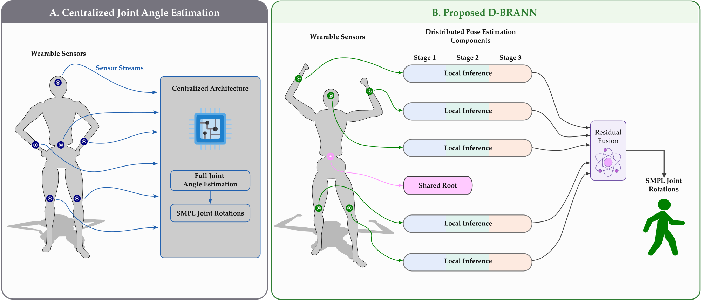
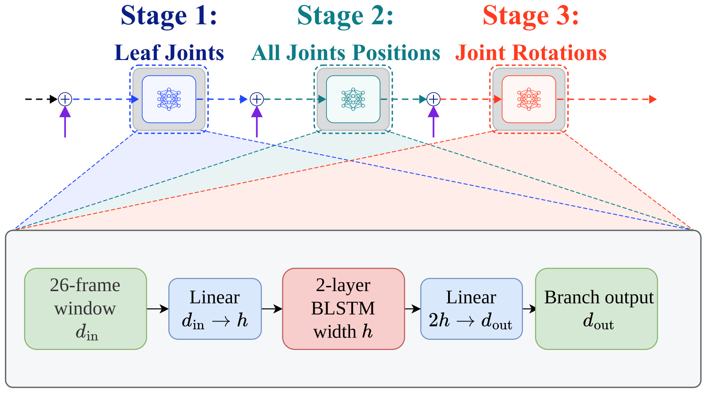
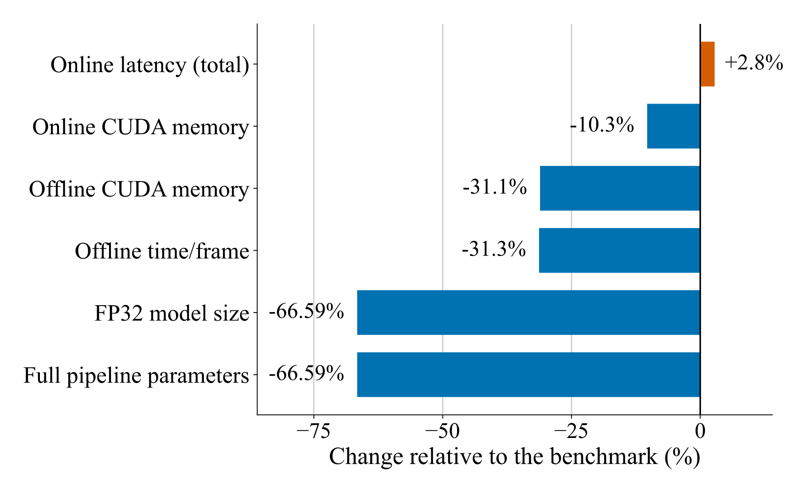

**D-BRANN** is a distributed bidirectional recurrent architecture for full-body human pose estimation from six sparse inertial measurement units (IMUs).

D-BRANN builds on the excellent work of [TransPose](https://github.com/Xinyu-Yi/TransPose) (Yi et al.), whose centralized architecture and translation modules (Trans-B1, Trans-B2) form the foundation this project extends into a distributed, branch-based design.

**Paper:** K. Niño-Tejada, J. L. Rivas-Caicedo, L. Saldaña-Aristizábal, and J. F. Patarroyo-Montenegro, "[D-BRANN: A Distributed Bidirectional Recurrent Neural Network for Full-Body Joint Angle Estimation from Sparse Inertial Measurement Units](https://doi.org/10.3390/electronics15215112)," *Electronics*, vol. 15, no. 21, p. 5112, 2026.

**Dataset:** [MoCap and IMU Dataset for Upper Limb Joint Angle Estimation](https://doi.org/10.5281/zenodo.15778950), Zenodo (2025).

{fig-alt="Side-by-side comparison: in (A) all wearable sensor streams feed one centralized network that outputs SMPL joint rotations; in (B) each sensor feeds its own three-stage local inference branch, the shared root IMU is shared across branches, and a residual fusion module produces the SMPL joint rotations."}

D-BRANN estimates full-body pose using six IMUs placed on:

- left forearm
- right forearm
- left lower leg
- right lower leg
- head
- root/pelvis

The architecture preserves the staged pose-estimation strategy while distributing the computation across anatomical branches.

{fig-alt="Architecture diagram: the six IMUs (left arm, right arm, left leg, right leg, trunk/head, and the shared hip/root IMU) feed five parallel branches. Each branch runs Stage 1 (leaf joints), Stage 2 (all-joint positions) and Stage 3 (joint rotations). The Stage 3 outputs go to a learned residual fusion module that outputs the full SMPL pose with 24 joints. The translation modules are unchanged."}

The original TransPose `Trans-B1` and `Trans-B2` modules are retained for translation estimation.

## Final architecture

| Stage | Organization | Hidden size | Output |
|---|---:|---:|---|
| Pose-S1 | 5 distributed branches | 32 | Leaf-joint positions |
| Pose-S2 | 5 distributed branches | 16 | Full-joint positions by anatomical branch |
| Pose-S3 | 5 distributed branches | 16 | Reduced-joint 6D rotations by anatomical branch |
| Rotation fusion | Learned residual fusion | 16 | Refined 90-dimensional rotation representation |
| Translation | Original Trans-B1 and Trans-B2 | Original configuration | Root translation |

Pose-S1 uses one local IMU and the shared root IMU for each branch. Pose-S2 and Pose-S3 continue the distributed processing with branch-specific joint subsets. The fusion network refines the assembled Pose-S3 output before conversion to the full SMPL pose.

{fig-alt="Diagram of the three stages (leaf joints, all-joint positions, joint rotations) and, expanded below, the internal structure shared by every stage module: a 26-frame window of dimension d_in, a linear layer d_in to h, a 2-layer bidirectional LSTM of width h, a linear layer 2h to d_out, and the branch output."}

### Parameter count

The current full-pipeline profiler reports:

| Pipeline | Parameters | FP32 parameter size |
|---|---:|---:|
| Original TransPose full pipeline | 4,798,771 | 18.306 MB |
| D-BRANN pose pipeline + original Trans-B1/B2 | 1,603,357 | 6.116 MB |

The resulting parameter ratio is **0.3341**, corresponding to approximately **66.6% fewer parameters** than the original full pipeline.

{fig-alt="Horizontal bar chart of the percentage change of D-BRANN relative to the benchmark: online latency (total) +2.8%, online CUDA memory -10.3%, offline CUDA memory -31.1%, offline time per frame -31.3%, FP32 model size -66.59%, full pipeline parameters -66.59%."}

## Where to go next

- [Repository structure](structure.qmd) — how the codebase is organized
- [Environment](environment.qmd) — set up the Conda environment
- [Checkpoints](checkpoints.qmd) — the validated model weights
- [Data](data.qmd) — datasets, SMPL assets, and staged training tensors
- [Training and data preparation](training.qmd) — the staged training workflow
- [Evaluation and profiling](evaluation.qmd) — running the smoke test and full evaluation
- [Xsens integration](xsens-calibration.qmd) — calibration, live inference, and Unity streaming

## License

Copyright © 2026 K. Niño-Tejada, J. L. Rivas-Caicedo, L. Saldaña-Aristizábal, and J. F. Patarroyo-Montenegro.

The source code is released under the [GNU General Public License v3.0](https://github.com/WearNET/D-BRANN/blob/main/LICENSE), as it builds on [TransPose](https://github.com/Xinyu-Yi/TransPose), which is distributed under the same license.

Portions of this code (`articulate/`, `net.py`, `utils.py`, and adapted parts of `config.py`, `scripts/baseline/evaluate_transpose.py`, and `scripts/data/preprocess_base_datasets.py`) are derived from [TransPose](https://github.com/Xinyu-Yi/TransPose) by Yi et al., also distributed under GPL-3.0.

Third-party assets are **not** covered by this license and are subject to their own terms: the SMPL model, the AMASS, DIP-IMU and TotalCapture datasets, and the original TransPose checkpoint. They are not redistributed here and must be obtained from their official sources. The MoCap and IMU dataset is released on Zenodo under CC BY 4.0.

## Citation

If you use D-BRANN in your research, please cite the paper ([DOI: 10.3390/electronics15215112](https://doi.org/10.3390/electronics15215112)):

```bibtex
@article{ninotejada2026dbrann,
  author  = {Ni{\~n}o-Tejada, Kevin and Rivas-Caicedo, Jhonathan L. and Salda{\~n}a-Aristiz{\'a}bal, Laura and Patarroyo-Montenegro, Juan F.},
  title   = {{D-BRANN}: A Distributed Bidirectional Recurrent Neural Network for Full-Body Joint Angle Estimation from Sparse Inertial Measurement Units},
  journal = {Electronics},
  year    = {2026},
  volume  = {15},
  number  = {21},
  pages   = {5112},
  doi     = {10.3390/electronics15215112}
}
```

If you use the dataset, please also cite it ([DOI: 10.5281/zenodo.15778950](https://doi.org/10.5281/zenodo.15778950)):

```bibtex
@misc{ninotejada2025mocap,
  author    = {Ni{\~n}o-Tejada, Kevin and Salda{\~n}a-Aristiz{\'a}bal, Laura and Rivas-Caicedo, Jhonathan L. and Patarroyo-Montenegro, Juan F.},
  title     = {{MoCap and IMU Dataset for Upper Limb Joint Angle Estimation}},
  year      = {2025},
  publisher = {Zenodo},
  doi       = {10.5281/zenodo.15778950}
}
```
